# islamic-reels-video

**RU:** скилл для Claude — исламские Reels/Shorts/TikTok на Remotion от и до.
**EN:** a Claude skill for end-to-end Islamic Reels/Shorts/TikTok production with Remotion.

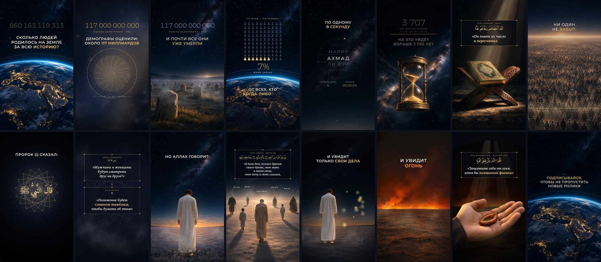

[Русский](#русский) · [English](#english) · [Примеры / Examples](#примеры--examples)

---

## Русский

Скилл учит Claude (Claude Code или claude.ai) делать вертикальные исламские ролики 1080×1920 по озвучке
и сценарию: от проверки аятов и хадисов до готового MP4. Скилл двуязычный: инструкция для Claude — на
английском (`SKILL.md`), русская копия — `SKILL.ru.md`, справочники — в `references/ru/` и `references/en/`.
Работает с озвучкой на любом языке.

### Что умеет
- **Проверка содержания:** аяты (сура:аят, арабский текст), хадисы (сборник и номер, формулировка), цифры.
- **Шариатские правила:** не изображать пророков, сподвижников и ангелов; люди без лиц, полный хиджаб;
  арабский текст только набором (не из ИИ-картинок).
- **Стиль и моушн-дизайн:** графические экраны, переходы, свет, дым, частицы, инфографика, метафоры.
- **Титры:** строгий капс, слово в слово по озвучке, ровные строки; цитаты аятов в стеклянных панелях.
- **Безопасная зона Reels** с автоматической проверкой каждого кадра.
- **Звук:** ускорение голоса без искажений, укорачивание пауз, громкость; фон — только нашид без
  инструментов или тихий эмбиент; тихие эффекты, синтезированные из шума.
- **Промты** для ИИ-картинок (без лиц, единый стиль серии) и для обложек.
- **Набор компонентов Remotion** и скрипты: проект, шрифты, голос, тайминги Whisper, картинки, кадры, проверка.

### Установка
**Claude Code** — скопируйте папку скилла в личные или проектные скиллы:
```bash
git clone https://github.com/one4zero/islamic-reels-video
cp -r islamic-reels-video/islamic-reels-video ~/.claude/skills/        # для всех проектов
# или: cp -r islamic-reels-video/islamic-reels-video <проект>/.claude/skills/
```
**claude.ai** — Настройки → Возможности → Skills → загрузить `dist/islamic-reels-video.skill`.

### Что нужно на компьютере
Node.js 20+ (браузер для рендера Remotion скачает сам) · ffmpeg с фильтром `rubberband` ·
Python 3.10+ и `pip install numpy pillow faster-whisper` · curl (шрифты из Google Fonts).

### Как пользоваться
Пришлите Claude озвучку (mp3/wav/ogg) и текст и напишите, например:
«Сделай ролик по этой озвучке, стиль — космос и инфографика, водяной знак — мой ник».
Claude проверит хадисы, предложит стиль, выдаст промты для картинок, соберёт ролик, покажет скриншоты
и после вашего «рендер» отрендерит MP4. Скрипты можно запускать и вручную — см. `SKILL.ru.md`.

---

## English

This skill teaches Claude (Claude Code or claude.ai) to produce vertical 1080×1920 Islamic videos from a
voiceover and a script: from checking ayat and hadith to the final MP4. The skill is bilingual: Claude's
instructions are in English (`SKILL.md`), a Russian copy is `SKILL.ru.md`, references are in
`references/en/` and `references/ru/`. Works with voiceovers in any language.

### Features
- **Content check:** ayat (surah:ayah, Arabic text), hadith (collection and number, wording), numbers.
- **Sharia rules:** never depict prophets, Companions or angels; faceless people, full hijab; Arabic text is
  always typeset in code (never taken from AI images).
- **Style and motion design:** graphic screens, transitions, light, fog, particles, infographics, metaphors.
- **Captions:** clean all-caps, word-for-word with the voiceover, balanced lines; ayah quotes in glass panels.
- **Reels safe zone** with an automatic check of every frame.
- **Audio:** distortion-free voice speed-up, pause trimming, loudness; background is only a nasheed without
  instruments or a quiet ambience; quiet noise-synthesized sound effects.
- **Prompts** for AI images (faceless, one consistent series style) and for covers.
- **Remotion component kit** and scripts: project, fonts, voice, Whisper timings, images, frames, checks.

### Install
**Claude Code** — copy the skill folder into your personal or project skills:
```bash
git clone https://github.com/one4zero/islamic-reels-video
cp -r islamic-reels-video/islamic-reels-video ~/.claude/skills/        # for all projects
# or: cp -r islamic-reels-video/islamic-reels-video <project>/.claude/skills/
```
**claude.ai** — Settings → Capabilities → Skills → upload `dist/islamic-reels-video.skill`.

### Requirements
Node.js 20+ (Remotion downloads its render browser) · ffmpeg with the `rubberband` filter ·
Python 3.10+ and `pip install numpy pillow faster-whisper` · curl (fonts from Google Fonts).

### Usage
Send Claude a voiceover (mp3/wav/ogg) and the text and write, for example:
"Make a reel from this voiceover, space + infographics style, watermark — my handle".
Claude checks the hadith, proposes a style, gives you image prompts, builds the video, shows screenshots
and renders the MP4 after you say "render". You can also run the scripts manually — see `SKILL.md`.

---

## Примеры / Examples

Кадры из ролика «117 миллиардов человек», собранного по этому скиллу (картинки — ИИ, вся графика — код).
Frames from the "117 billion people" reel made with this skill (pictures — AI, all graphics — code).

| | | | |
|---|---|---|---|
| 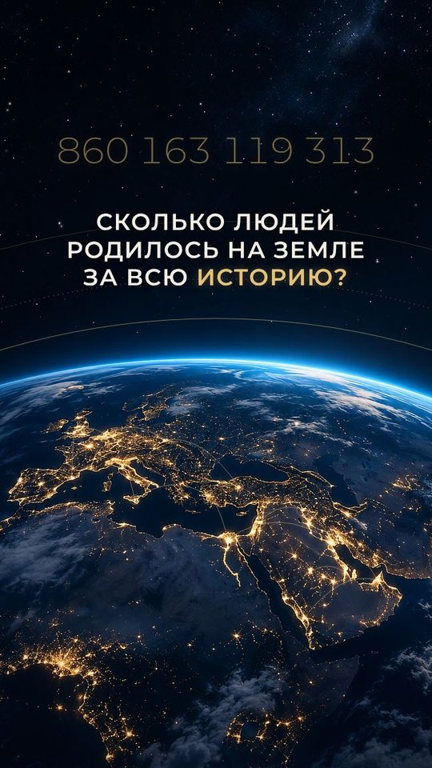 | 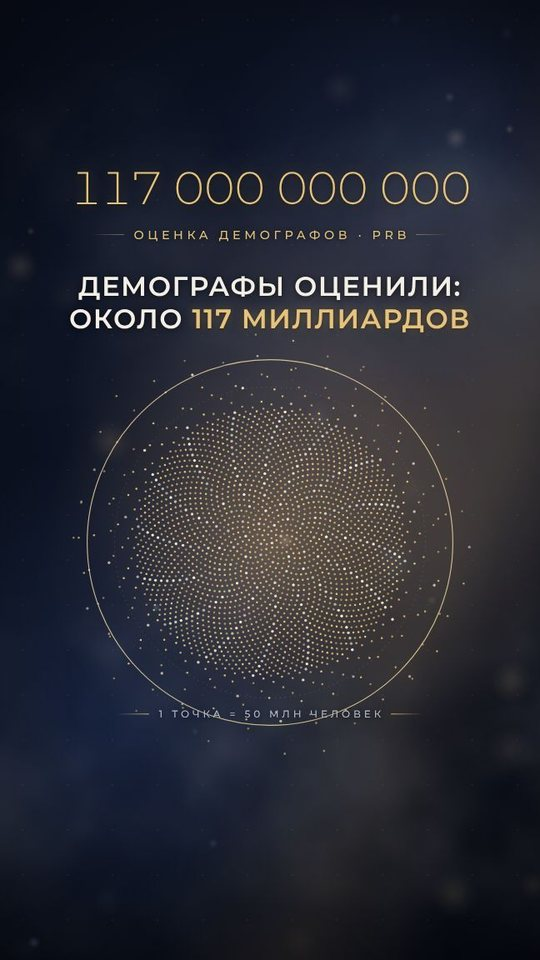 | 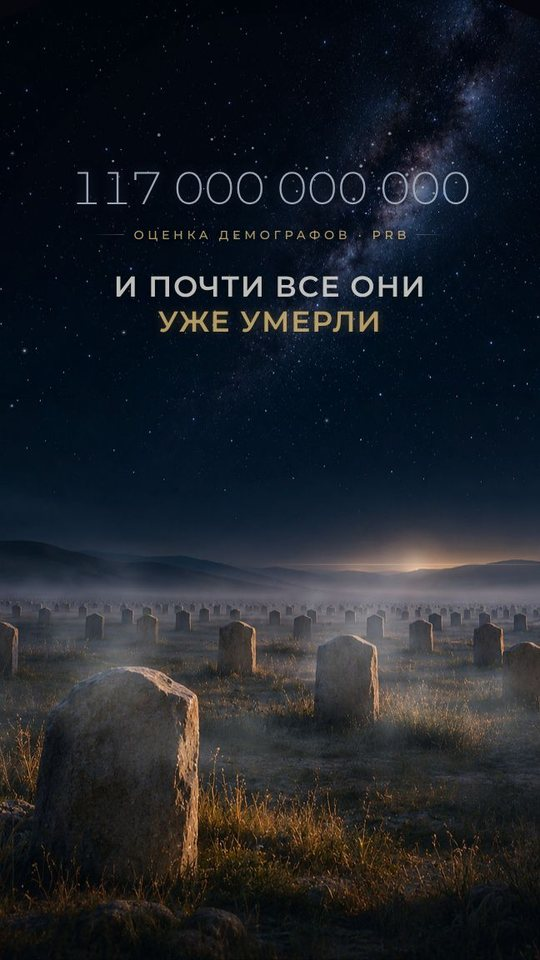 | 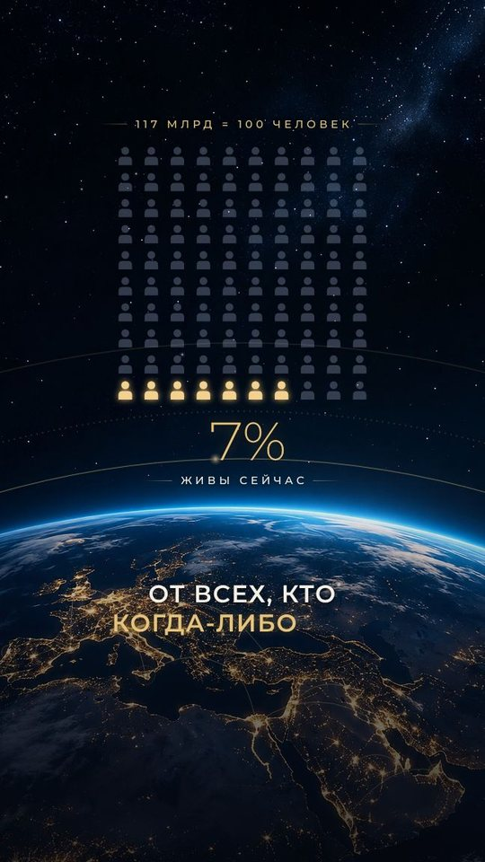 |
| Хук: табло цифр над Землёй / Hook: digit counter over Earth | Галактика из точек: 1 точка = 50 млн / Dot galaxy: 1 dot = 50M | Цифры гаснут: «почти все умерли» / Counter turns grey | Сетка 100 человек, светятся 7% / 100-people grid, 7% lit |
| 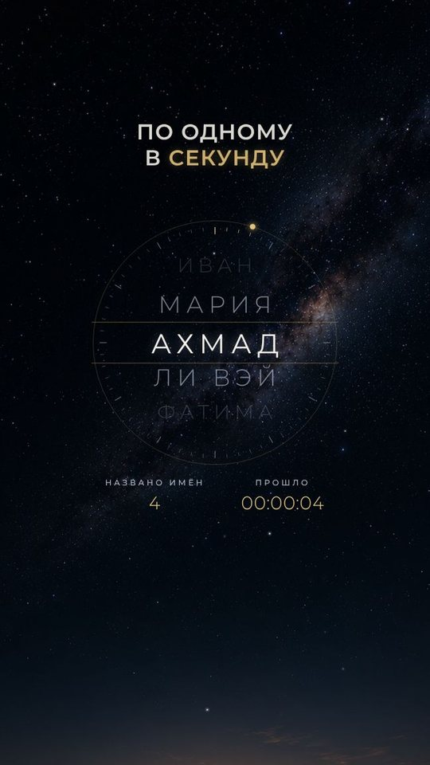 | 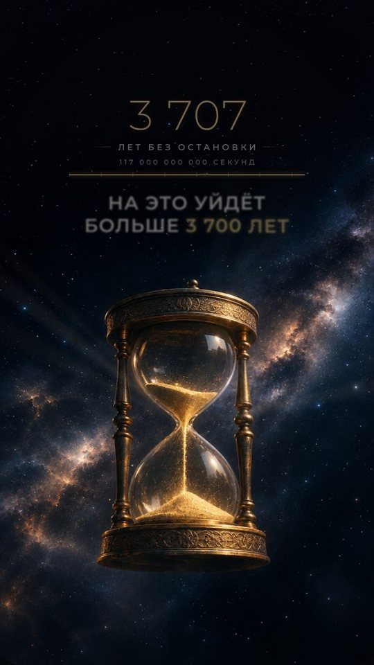 | 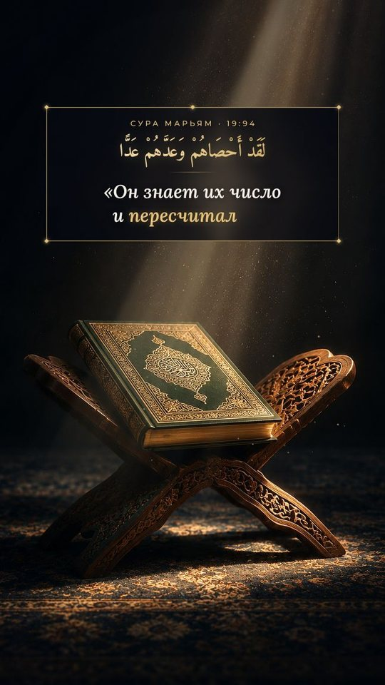 | 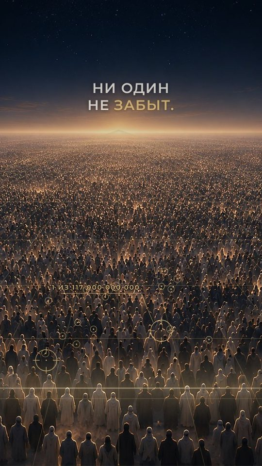 |
| Лента имён и циферблат / Names ribbon and dial | Песочные часы и шкала лет / Hourglass and years scale | Аят в стеклянной панели / Ayah in a glass panel | Прицелы и перспективная сетка / Reticles and perspective grid |
| 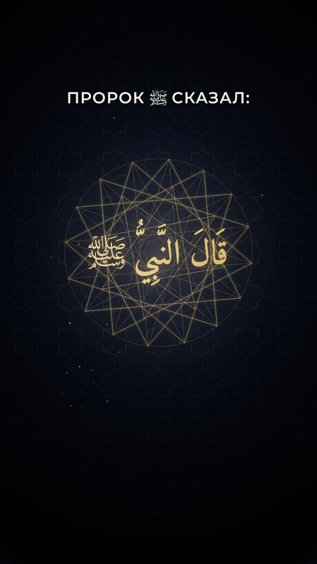 | 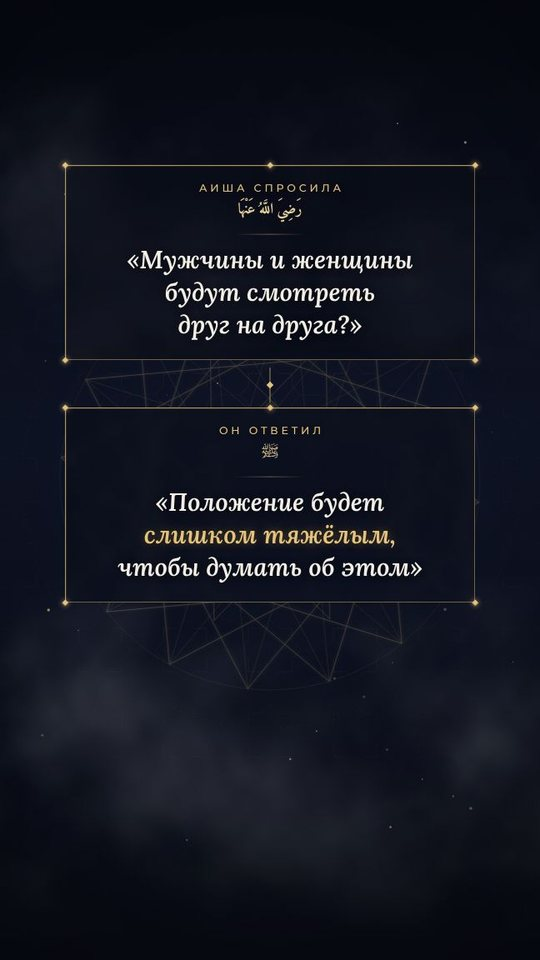 | 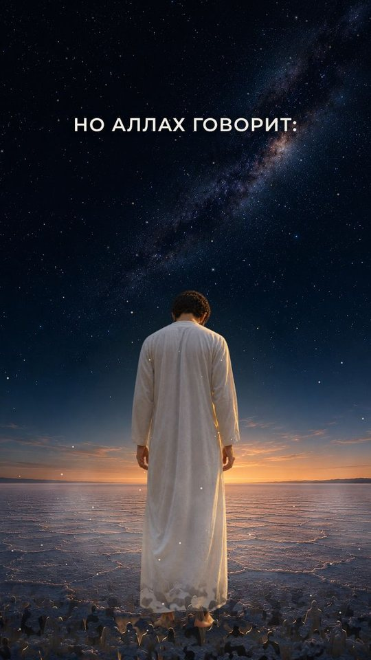 | 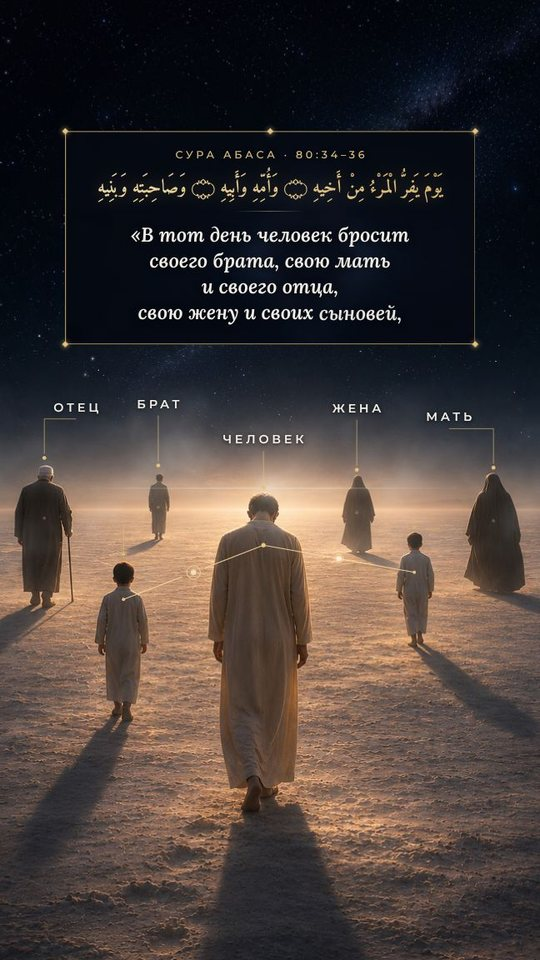 |
| «Пророк ﷺ сказал»: орнамент и каллиграфия / Prophet ﷺ card | Диалог из хадиса / Hadith dialogue | Толпа рассыпается в пыль / Crowd dissolves into dust | Подписи и нити к фигурам / Labels and threads |
| 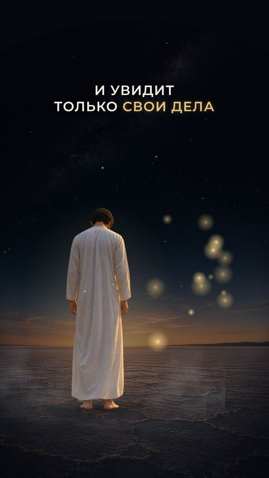 | 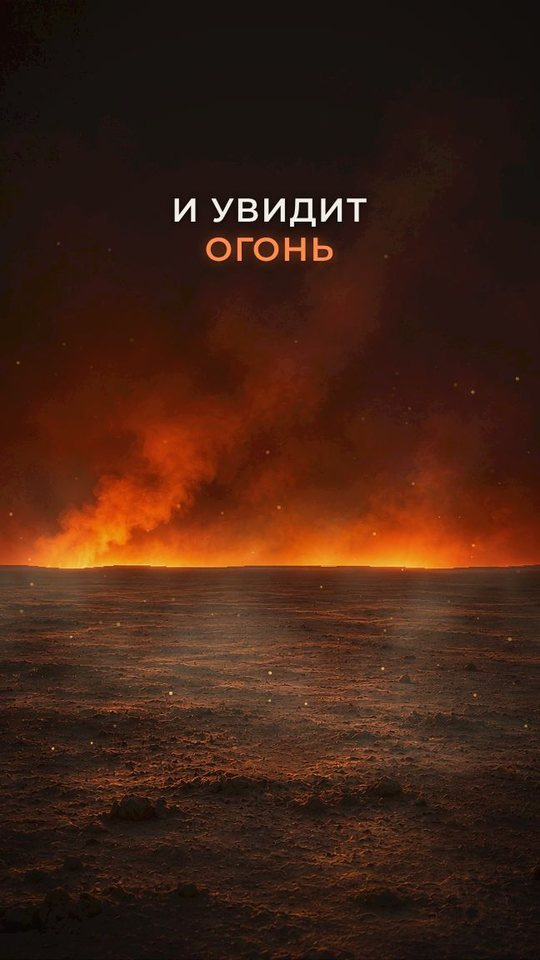 | 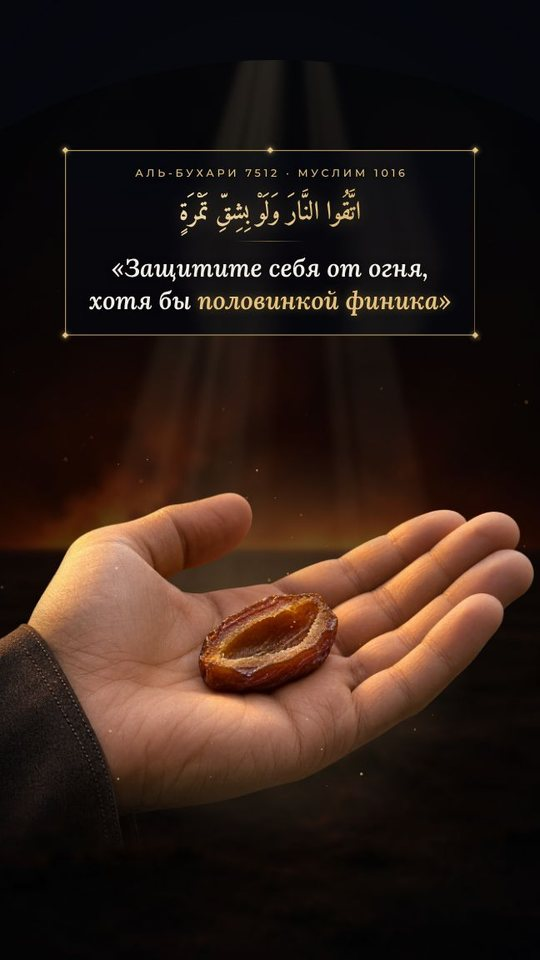 | 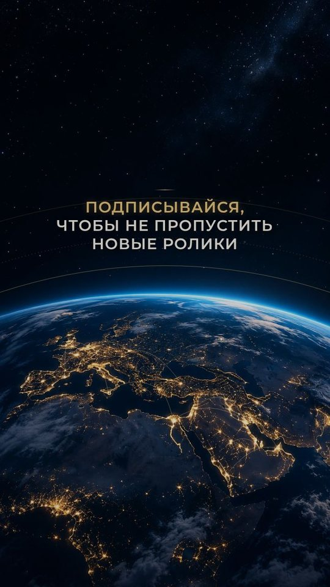 |
| Огни дел и световые следы / Deeds lights and trails | Огонь: жар, искры, вспышка / Fire: heat, embers, flash | Хадис с арабским текстом / Hadith with Arabic | Финал / Outro |

---

## Структура / Structure
```
islamic-reels-video/
  SKILL.md, SKILL.ru.md          process end to end / процесс от и до (EN / RU)
  references/en, references/ru   style, captions & safe zone, religious rules, audio, image prompts,
                                 covers, component kit, delivery / стиль, титры, правила, звук, промты,
                                 обложки, компоненты, сдача
  scripts/                       new_project, get_fonts, prep_voice, transcribe, align, mix_bed, gen_sfx,
                                 prep_art, gen_fog, stills, contact_sheet, probe + check_safe
  assets/remotion-kit/           Remotion project template with components / шаблон проекта
  assets/examples/               full example scene / пример полной сцены
dist/islamic-reels-video.skill   packaged skill for claude.ai / упакованный скилл
docs/                            screenshots / скриншоты
```

## Лицензии и ответственность / Licenses and responsibility
- Code and skill texts — MIT (see LICENSE). / Код и тексты скилла — MIT.
- Fonts Montserrat, Lora, Amiri — SIL Open Font License, downloaded from Google Fonts. / Шрифты — SIL OFL.
- Remotion has its own license (free for individuals and small teams; companies may need a paid license) —
  https://remotion.dev/license. / У Remotion своя лицензия.
- The skill helps check sources, but the author of a video is responsible for its religious content; when in
  doubt, consult people of knowledge. / Ответственность за религиозное содержание — на авторе ролика.
